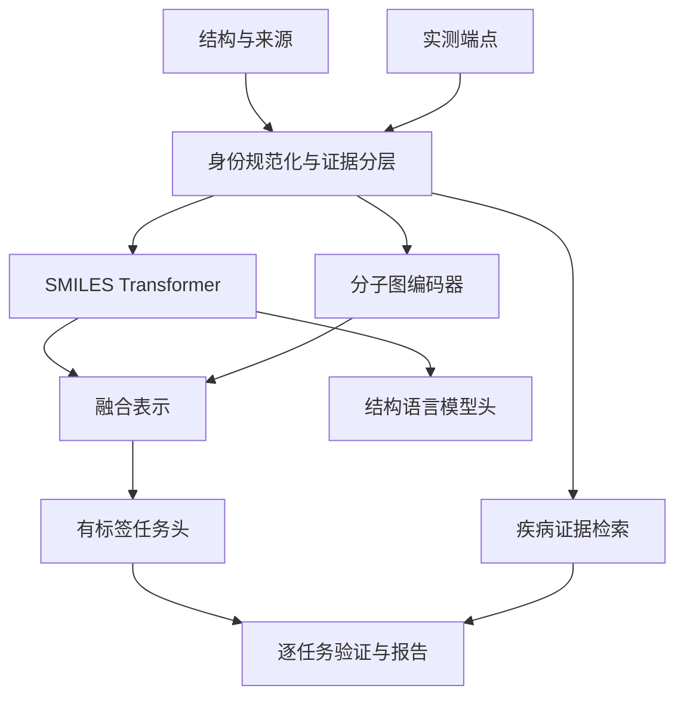

# NP-FM：天然产物结构、成药性与适应症证据研究框架

本模块属于 [Natural-Products-AI-1](https://github.com/zhu-algorithm/Natural-Products-AI-1)，连接天然产物数据库、分子表示学习、实测性质预测与适应症证据。

**版本 0.1.1，2026-11-15。** 这是可运行、可训练的研究原型。恢复版本的所有交付数量、模型指标和测试状态以 `docs/DELIVERY_STATUS.md` 与 `reports/` 为准；不沿用中断前已经丢失的权重或指标。

## 这个系统如何对应“天然化合物语言模型”

化合物结构是结构预训练语料，表示为保留手性的SMILES及分子图。真实成药性规律需要实验端点作为监督信号；结构语料本身不会自动产生口服暴露、毒性、有效剂量或疾病疗效标签。疾病适应症还需要靶点、机制、疾病背景及不同证据等级。系统因此分别训练结构语言模型和有标签的性质任务，并通过可追溯检索组织疾病证据。

| 模块 | 已实现用途 | 解释边界 |
|---|---|---|
| 数据注册表和下载器 | 来源URL、许可、版本、校验值、失败及未下载状态 | 注册来源不等于全部已下载 |
| 结构统一与合并 | CSV/JSONL/SDF输入、完整InChIKey、来源字段 | 保留立体化学；未知来源不自动确认为天然 |
| 化学计算 | RDKit描述符、手性感知相似性、ETKDG构象及能量最小化 | 计算值不作为实验真值 |
| 分子网络 | SMILES Transformer和二维消息传递图编码器 | 紧凑的原创研究实现 |
| 结构自监督 | 因果语言建模、跨表示对齐 | 学习结构分布，不等同成药性 |
| 监督任务 | 回归、二分类、多分类、缺失标签掩码 | 仅输出实际训练过的任务头 |
| 疾病证据 | 化合物、靶点、疾病、研究阶段与来源检索 | 没有可靠校准的临床疗效概率 |
| 评估 | 骨架、身份、分组、时间拆分和逐端点指标 | 小样本随机结果不能代替外部验证 |
| 外部适配器 | ADMET-AI、AutoDock Vina调用入口 | 需要另行安装软件、权重和环境 |
| 第三方算法目录 | 固定版本源码、原始论文、许可与集成状态 | 不代表所有方法均已复现或集成 |

## 安装与快速运行

在本模块目录执行，需要 Python 3.10+。本次实际验证平台是Linux CPU。

```bash
python -m venv .venv
source .venv/bin/activate
# Windows PowerShell: .venv\Scripts\Activate.ps1
python -m pip install --upgrade pip
python -m pip install -e '.[train,test]'
npfm doctor
python -m pytest
npfm descriptors --input examples/compounds.csv --output runs/descriptors.csv
npfm evidence --compound paclitaxel --output runs/paclitaxel_evidence.json
npfm evidence --compound artemisinin --output runs/artemisinin_evidence.json
```

CPU可先执行 `python -m pip install torch --index-url https://download.pytorch.org/whl/cpu`。GPU用户需按照驱动选择PyTorch安装版本。

交付时的实际联合训练权重位于 `checkpoints/joint_pilot`。直接分析化合物表：

```bash
npfm analyze --input examples/compounds.csv --checkpoint checkpoints/joint_pilot --output runs/analysis
```

输出包括计算结构性质、已训练任务的预测及有来源的适应症证据。证据通过重新计算的完整分子身份连接，不能仅通过输入药名冒认另一个结构的适应症。示例中的紫杉醇、青蒿素与青蒿琥酯分别保存身份，不互相继承临床证据。

## 数据与实测端点

```bash
npfm catalog databases
npfm catalog algorithms
npfm catalog endpoints
npfm download list
npfm download plan --all
npfm download fetch --ids coconut,lotus --output data/raw
npfm upstream list --all-permitted
npfm upstream fetch --all-permitted --output third_party/source_snapshots
```

具体ID以注册表为准。目录涵盖天然产物库和一般药化、靶点、疾病、谱学等辅助资源。失效链接、付费资源、登录和许可限制会保留明确状态。“全部”下载选项仅选择本注册表允许自动获取的条目。

独立数据包提供COCONUT和LOTUS的规范化表与完整InChIKey联合表。其规模以本次重新校验的清单为准。来源映射保留原始行和可获得的物种、文献字段；COCONUT lite未提供的原始证据不会被虚构补齐。

```bash
npfm data merge data/normalized/coconut_compounds.csv data/normalized/lotus_compounds.csv --output data/normalized/coconut_lotus_union_compounds.csv
```

监督数据至少需要 `compound_id,smiles` 和对应任务的实测值。还应保留实验条件、单位、物种、给药途径、来源及时间。未知值留空；文献未报道不等于阴性。

提供真实ESOL水溶解度训练例程，读取 measured log solubility 列。ESOL是一般小分子基准，不能证明天然产物ADMET外部有效性。

```bash
python scripts/prepare_solubility.py --natural-products examples/compounds.csv
npfm train --config configs/solubility_pilot.json
npfm predict --checkpoint runs/solubility_pilot --input examples/compounds.csv --output runs/logS_predictions.csv
```

完整语料可通过 `npfm train --data` 接入；正式训练前应检查序列长度、原子预算和计算资源。模型不静默截断复杂天然产物。每次运行保存输入哈希、配置、词表、身份/骨架分组、任务来源、权重和评估记录。词表及标准化统计仅从训练部分估计，验证集选模后才报告测试集。

## 架构



“成药性”需要按疾病、给药途径、剂量和作用机制分别判断。QED、NP-likeness、合成可及性、对接分数及预测溶解度各有定义，不能简单相加成为临床成功概率。生成分子也需要化学、可制备性及实验验证。

## 许可与可复现性

原创代码采用MIT许可。原始数据库、第三方源码、预训练权重和论文分别遵循自己的条款。公开GitHub保存原创代码、目录、来源记录、必要示例和本项目试验权重；大型数据库及带非商业/混合许可的数据另行打包。第三方源码包保留固定commit及原许可证，排除上游数据、权重与一般二进制资产。

可选外部适配器没有安装验证的项目会明确标记，Docker文件仅提供构建入口。训练脚本、源码快照、可运行权重与成功复现是不同状态。

## 原始来源

- [COCONUT](https://coconut.naturalproducts.net/download)
- [LOTUS](https://doi.org/10.7554/eLife.70780)
- [NPASS 2026](https://doi.org/10.1093/nar/gkaf1196)
- [NaFM](https://www.nature.com/articles/s42256-026-01226-8)
- [NPGPT](https://doi.org/10.1007/s11227-024-06860-w)
- [Chemprop](https://github.com/chemprop/chemprop)
- [ADMET-AI](https://github.com/swansonk14/admet_ai)
- [ESOL](https://doi.org/10.1021/ci034243x)
- [AutoDock Vina](https://autodock-vina.readthedocs.io/en/latest/docking_python.html)
