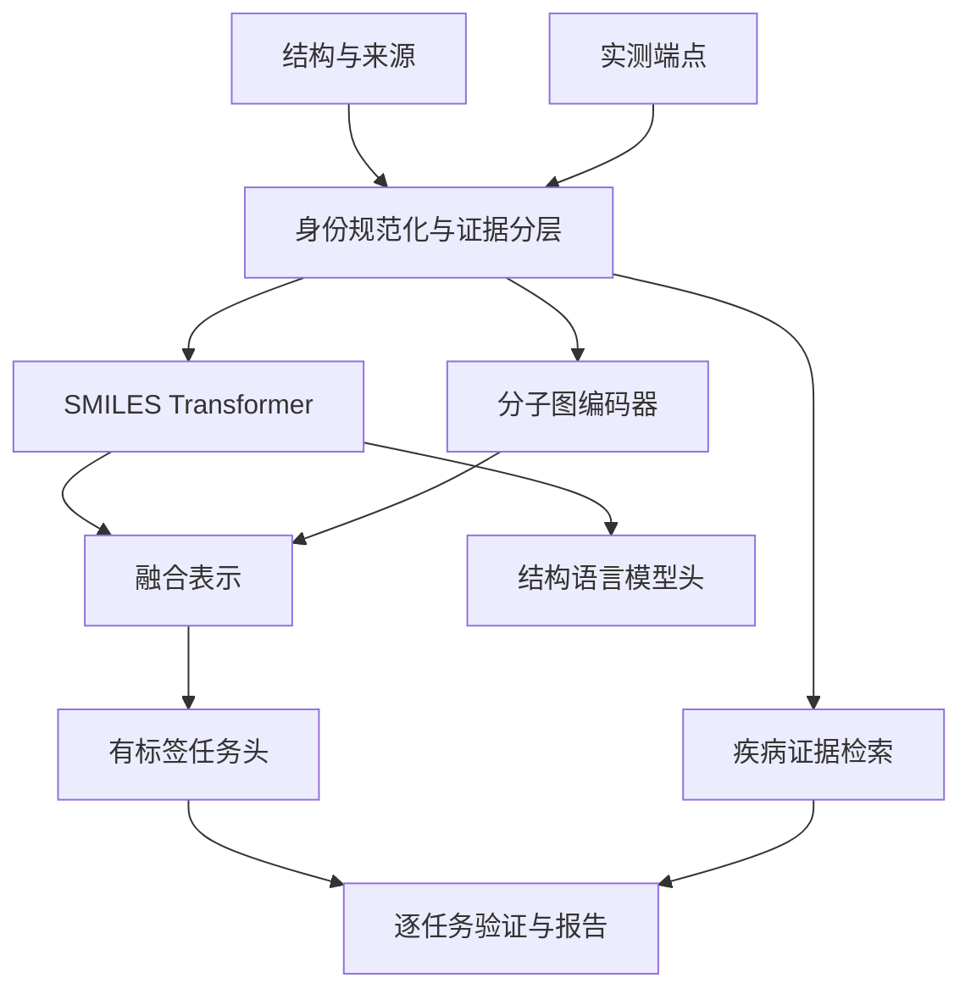

# NP-FM / NP-GPT 0.2：天然产物结构语言模型与药化研究框架

本模块属于 [Natural-Products-AI-1](https://github.com/zhu-algorithm/Natural-Products-AI-1)，连接天然产物数据库、分子表示学习、实测性质预测与适应症证据。

**版本 0.2.0，2026-11-15。** 本版发布从零训练的 **NP-GPT decoder-only Transformer**，以及固定训练检查点、原始生成记录、同测试集基线和评测依据。实际发布模型有 **331,680 个参数**，在 COCONUT/LOTUS 联合语料的 **688,166 条合格训练序列上完成一个完整 epoch**。这是紧凑结构语言模型，不是已训练的十亿参数模型。

模型和指标见 [NP-GPT 模型卡](docs/NP_GPT_MODEL_CARD.md)、[发布检查点](models/np_gpt_v0.2/)与 [CHANGELOG](CHANGELOG.md)。v0.1 的结构/图融合、实测 logS pilot、化学计算和证据检索继续保留；其历史结果位于 `checkpoints/joint_pilot/`、`docs/DELIVERY_STATUS.md` 与 `reports/`，不混作 NP-GPT 的训练结果。

## 本次实际训练与生成结果

联合结构 CSV 有 764,701 行；预处理合格分区为 train 688,166、validation 37,720、test 38,810。模型完整遍历 **train**；验证与测试分别按固定种子抽取 **4,096 条**，没有在全部验证或测试记录上计算下表指标。词表为 376，最大上下文为 1,024，划分按来源 InChIKey 连接层身份分组，**不是骨架拆分**。[语料清单](models/np_gpt_v0.2/corpus_manifest.json)

| 同一测试集合：4,096 序列、269,469 个预测 token | Token NLL，越低越好 | Perplexity，越低越好 |
|---|---:|---:|
| 训练部分拟合的 unigram，加性平滑 0.1 | 2.239964 | 9.392995 |
| 训练部分拟合的 bigram，加性平滑 0.1 | 1.770690 | 5.874906 |
| NP-GPT，331,680 参数 | **0.658853** | **1.932575** |

模型按验证 NLL 选择检查点，随后计算测试；验证 NLL 为 0.660124。训练共 11,296 次参数更新、45,457,285 个预测目标 token，在本次 CPU 4 线程环境用时 1,136.12 秒。耗时是本次记录，不是其他硬件的运行保证。[训练报告](models/np_gpt_v0.2/training_report.json)；[基线报告](models/np_gpt_v0.2/token_baselines.json)

固定 512 次生成使用 seed 2026、temperature 0.8、top-k 50、top-p 0.95、最多 512 个新 token、batch 32；全部尝试保留，没有修复或补采样：

| 生成指标 | 分子 / 分母 | 结果 |
|---|---:|---:|
| EOS 正常结束 | 512 / 512 | 100.00% |
| RDKit 解析有效 | 439 / 512 | 85.7422% |
| 有效结构唯一率 | 434 / 439 | 98.8610% |
| 相对合格训练参考未命中 | 354 / 434 | 81.5668% |
| 相对完整语料快照未命中 | 340 / 434 | 78.3410% |

“未命中”只表示在本次快照和明确身份规则下未收录，不证明世界首次发现、天然存在、可合成、药效或成药性。[原始生成尝试](models/np_gpt_v0.2/generated_512.jsonl)；[评测详情](models/np_gpt_v0.2/generation_evaluation.json)

## 这个系统如何对应“天然化合物语言模型”

化合物结构是结构预训练语料。NP-GPT v0.2 使用带手性等化学记号的 SMILES；v0.1 联合模型另使用分子图。真实成药性规律需要实验端点作为监督信号；结构语料本身不会自动产生口服暴露、毒性、有效剂量或疾病疗效标签。疾病适应症还需要靶点、机制、疾病背景及不同证据等级。NP-GPT 的 `trained_property_tasks` 为空；旧版 logS 模型和外部 ADMET 预测器是独立模块。

| 模块 | 已实现用途 | 解释边界 |
|---|---|---|
| 数据注册表和下载器 | 来源URL、许可、版本、校验值、失败及未下载状态 | 注册来源不等于全部已下载 |
| 结构统一与合并 | CSV/JSONL/SDF输入、完整InChIKey、来源字段 | 保留立体化学；未知来源不自动确认为天然 |
| 化学计算 | RDKit描述符、手性感知相似性、ETKDG构象及能量最小化 | 计算值不作为实验真值 |
| NP-GPT v0.2 | Decoder-only Transformer、完整序列语料、KV cache 生成、EOS/mean 表征 | 项目编写工程实现，使用已有 Transformer 方法 |
| v0.1 分子网络 | SMILES Transformer和二维消息传递图编码器 | 独立的结构/图联合研究模型 |
| 结构自监督 | NP-GPT 下一 token 预测；v0.1 另有跨表示对齐 | 学习结构分布，不等同成药性 |
| 监督任务 | 回归、二分类、多分类、缺失标签掩码 | 仅输出实际训练过的任务头 |
| 疾病证据 | 化合物、靶点、疾病、研究阶段与来源检索 | 没有可靠校准的临床疗效概率 |
| 评估 | 骨架、身份、分组、时间拆分和逐端点指标 | 小样本随机结果不能代替外部验证 |
| 外部适配器 | ADMET-AI、AutoDock Vina调用入口 | 需要另行安装软件、权重和环境 |
| 第三方算法目录 | 固定版本源码、原始论文、许可与集成状态 | 不代表所有方法均已复现或集成 |

## 安装与快速运行

在本模块目录执行，需要 Python 3.10+。本次实际验证平台是Linux CPU。

```bash
python -m venv .venv
source .venv/bin/activate
# Windows PowerShell: .venv\Scripts\Activate.ps1
python -m pip install --upgrade pip
python -m pip install -e '.[train,test]'
npfm doctor
python -m pytest
npfm descriptors --input examples/compounds.csv --output runs/descriptors.csv
npfm evidence --compound paclitaxel --output runs/paclitaxel_evidence.json
npfm evidence --compound artemisinin --output runs/artemisinin_evidence.json
```

CPU可先执行 `python -m pip install torch --index-url https://download.pytorch.org/whl/cpu`。GPU用户需按照驱动选择PyTorch安装版本。

### 直接使用已训练的 NP-GPT

在本模块目录执行。分片只保存一套权重；加载器验证完整权重、每个分片、模型配置和词表的 hash，不需要手动拼接。

```bash
npfm np-gpt generate --checkpoint models/np_gpt_v0.2 --n 16 --max-new-tokens 256 --seed 42 --cpu-threads 2 --output runs/generated_smoke.jsonl
npfm np-gpt score --checkpoint models/np_gpt_v0.2 --input examples/compounds.csv --smiles-column smiles --id-column compound_id --cpu-threads 2 --output runs/np_gpt_representations
```

`score` 输出 `sequence_metrics.csv`、`eos_embeddings.npy`、`mean_embeddings.npy` 和带检查点 hash 的 manifest。通过 `embedding_row` 连接向量与输入；OOV、超长或分词失败保留状态，向量矩阵不补零占位。该接口检查序列词法与预算，化学解析和身份 QC 由调用者负责。输出目录必须为空。NLL/perplexity 依赖 SMILES 的写法，不是天然来源、成药性、毒性或疗效概率。

### 从公开结构语料复现 NP-GPT

将另行获取并规范化的公开联合表放在 `data/normalized/coconut_lotus_union_compounds.csv`。输入需含 `smiles` 和完整来源 `full_inchikey`；可带 `compound_id` 与来源字段。`prepare` 会保存全部原始行及失败原因，用 RDKit 规范结构作审计，并只从合格训练分区拟合词表。训练 token 仍对应输入的原始 SMILES；规范化政策不同会改变词表与语言指标。

```bash
npfm np-gpt prepare --input data/normalized/coconut_lotus_union_compounds.csv --output data/np_gpt_corpus --max-seq-length 1024 --seed np-gpt-v1
npfm np-gpt train --config configs/np_gpt_cpu.json --corpus data/np_gpt_corpus --output runs/np_gpt_cpu
python -m npfm.np_gpt.baselines --corpus data/np_gpt_corpus --limit 4096 --seed 44 --output runs/token_baselines.json
```

`configs/np_gpt_cpu.json` 为本次实际训练超参数。`small`、`base` GPU 文件是未训练的容量模板，不能当作已完成的更大模型。训练保存分区 hash、实际见过的公开语料行号、预测 token 数、优化器步数、验证选模和测试报告。继续同一次训练需要该运行目录的 `resume.pt` 与其 hash，并保持原配置及同一输出目录：

```bash
npfm np-gpt train --config configs/np_gpt_cpu.json --corpus data/np_gpt_corpus --output runs/np_gpt_cpu --resume runs/np_gpt_cpu/resume.pt
```

发布文件夹是推理检查点，不含优化器恢复状态。实际 seen row IDs 的无损压缩记录用于公开语料曝光审计；它不是额外模型权重。

复现已报告的固定生成批次及新颖性评测：

```bash
npfm np-gpt generate --checkpoint models/np_gpt_v0.2 --n 512 --max-new-tokens 512 --temperature 0.8 --top-k 50 --top-p 0.95 --seed 2026 --batch-size 32 --cpu-threads 4 --output runs/generated_512.jsonl
npfm np-gpt evaluate --input runs/generated_512.jsonl --corpus data/np_gpt_corpus --output runs/generation_evaluation.json
```

新颖性评测需要与发布清单相符的完整 `metadata.sqlite`，不会在缺少参考数据时填“全部新颖”。固定 seed 有助于复现，但不同 PyTorch、硬件或数值实现可能产生不同抽样序列；发布的原始 attempts 是本次结果的审计依据。

### 保留的 v0.1 联合模型

实际联合训练权重位于 `checkpoints/joint_pilot`。它提供另行监督过的 logS 任务；直接分析化合物表：

```bash
npfm analyze --input examples/compounds.csv --checkpoint checkpoints/joint_pilot --output runs/analysis
```

输出包括计算结构性质、已训练任务的预测及有来源的适应症证据。证据通过重新计算的完整分子身份连接，不能仅通过输入药名冒认另一个结构的适应症。示例中的紫杉醇、青蒿素与青蒿琥酯分别保存身份，不互相继承临床证据。

## 数据与实测端点

```bash
npfm catalog databases
npfm catalog algorithms
npfm catalog endpoints
npfm download list
npfm download plan --all
npfm download fetch --ids coconut,lotus --output data/raw
npfm upstream list --all-permitted
npfm upstream fetch --all-permitted --output third_party/source_snapshots
```

具体ID以注册表为准。目录涵盖天然产物库和一般药化、靶点、疾病、谱学等辅助资源。失效链接、付费资源、登录和许可限制会保留明确状态。“全部”下载选项仅选择本注册表允许自动获取的条目。

独立数据包提供COCONUT和LOTUS的规范化表与完整InChIKey联合表。其规模以本次重新校验的清单为准。来源映射保留原始行和可获得的物种、文献字段；COCONUT lite未提供的原始证据不会被虚构补齐。

```bash
npfm data merge data/normalized/coconut_compounds.csv data/normalized/lotus_compounds.csv --output data/normalized/coconut_lotus_union_compounds.csv
```

监督数据至少需要 `compound_id,smiles` 和对应任务的实测值。还应保留实验条件、单位、物种、给药途径、来源及时间。未知值留空；文献未报道不等于阴性。

提供真实ESOL水溶解度训练例程，读取 measured log solubility 列。ESOL是一般小分子基准，不能证明天然产物ADMET外部有效性。

```bash
python scripts/prepare_solubility.py --natural-products examples/compounds.csv
npfm train --config configs/solubility_pilot.json
npfm predict --checkpoint runs/solubility_pilot --input examples/compounds.csv --output runs/logS_predictions.csv
```

v0.1 有标签任务可通过 `npfm train --data` 接入；大规模结构语言训练使用上文的 `npfm np-gpt prepare/train`。正式训练前应检查序列长度、原子预算和计算资源。模型不静默截断复杂天然产物。每次运行保存输入哈希、配置、词表、身份/骨架分组、任务来源、权重和评估记录。词表及标准化统计仅从训练部分估计，验证集选模后才报告测试集。

发行版的较大拆分记录以 `splits.json.gz` 无损保存，程序直接读取并按原始解压字节校验SHA256；无需手动解压。压缩不改变训练拆分或模型权重。

## 架构

NP-GPT v0.2 是纯 PyTorch 编写的 decoder-only Transformer：**causal SDPA、RoPE、RMSNorm、SwiGLU、GQA 与输入/输出权重绑定**。已训练配置为 3 层、隐藏维度 96、6 个 query heads、2 个 KV heads、前馈维度 256、376 词表、1,024 上下文。生成复用 KV cache；语言头只读取因果前缀；API 可选择返回最终 token 隐藏状态供后续另行监督研究。

这些是已有方法的工程实现，不是新的 Transformer 数学理论；代码未复制外部模型实现或使用外部预训练权重。各组件原始来源与实现边界见[模型卡](docs/NP_GPT_MODEL_CARD.md#2-已实现架构与方法来源)。

下面为继续保留的 **v0.1 结构/图联合分支**：



“成药性”需要按疾病、给药途径、剂量和作用机制分别判断。QED、NP-likeness、合成可及性、对接分数及预测溶解度各有定义，不能简单相加成为临床成功概率。生成分子也需要化学、可制备性及实验验证。

## 许可与可复现性

原创代码采用MIT许可。原始数据库、第三方源码、预训练权重和论文分别遵循自己的条款。公开GitHub保存原创代码、目录、来源记录、必要公开示例及本项目训练权重；大型数据库按各自许可另行提供。第三方源码包保留固定commit及原许可证，排除上游数据、权重与一般二进制资产。NP-GPT 训练来源仅为本次登记的公开 COCONUT/LOTUS 结构快照，来源和归属见模型文件夹的 `ATTRIBUTION.md`。

`models/np_gpt_v0.2/release_manifest.json` 提供模型发行文件清单与 hash。`scripts/build_release.py` 是保留的 v0.1.1 全资源打包流程，会生成旧 pilot 的交付报告；不要用它覆盖本版模型发行目录或新模型卡。

可选外部适配器没有安装验证的项目会明确标记，Docker文件仅提供构建入口。训练脚本、源码快照、可运行权重与成功复现是不同状态。

## 原始来源

- [COCONUT](https://coconut.naturalproducts.net/download)
- [LOTUS](https://doi.org/10.7554/eLife.70780)
- [NPASS 2026](https://doi.org/10.1093/nar/gkaf1196)
- [NaFM](https://www.nature.com/articles/s42256-026-01226-8)
- [NPGPT](https://doi.org/10.1007/s11227-024-06860-w)
- [Chemprop](https://github.com/chemprop/chemprop)
- [ADMET-AI](https://github.com/swansonk14/admet_ai)
- [ESOL](https://doi.org/10.1021/ci034243x)
- [AutoDock Vina](https://autodock-vina.readthedocs.io/en/latest/docking_python.html)
